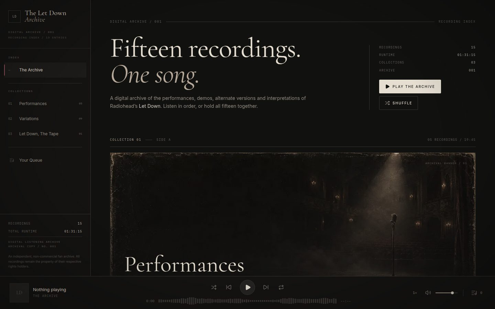
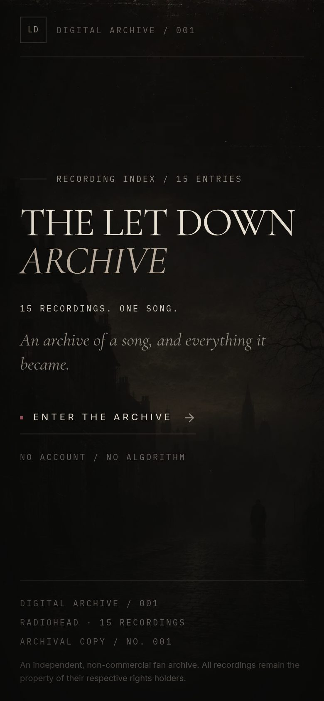

# The Let Down Archive

A digital listening archive for fifteen recordings of one song — Radiohead's "Let Down". Built as a complete, deployable Next.js application with a cinematic landing page, three collections, a persistent player, a reorderable queue, and multi-select custom queues.

> **Audio is not included.** This repository ships the complete interface and all artwork, but no copyrighted recordings. Add your own audio files to `public/audio` (or point the app at an external host) to enable playback. The app remains fully navigable without them and shows the exact expected file path when a recording is missing.

## Preview





## Stack

- Next.js 16 (App Router, Turbopack)
- React 19 + TypeScript
- Tailwind CSS v4 (CSS-first theme)
- Motion for React for transitions, panels and drag-to-reorder
- Lucide icons
- `next/font` with Cormorant Garamond, Inter and IBM Plex Mono

## Run locally

```bash
npm install
npm run dev
```

Open [http://localhost:3000](http://localhost:3000).

Other scripts:

```bash
npm run build    # production build
npm run start    # serve the production build
npm run lint     # ESLint
```

Node.js 20.9 or newer is required.

## Add your audio

Create the files below inside `public/audio/...`. The filenames are read from `src/data/tracks.ts`; use them exactly.

| # | Collection | Recording | Length | File |
|---|---|---|---|---|
| 01 | Performances | 14 November 1995 | 4:52 | `public/audio/performances/1995-11-14_letdown.mp3` |
| 02 | Performances | 14 March 1996 | 4:06 | `public/audio/performances/1996-03-14letdown.mp3` |
| 03 | Performances | 26 July 1996 | 4:38 | `public/audio/performances/1996-07-26letdown.mp3` |
| 04 | Performances | 19 August 1996 | 4:24 | `public/audio/performances/1996-08-19letdown.mp3` |
| 05 | Performances | The Four-Track Demo | 1:45 | `public/audio/performances/oknotok_letdown4track.mp3` |
| 06 | Variations | Let Down 9.1 | 4:56 | `public/audio/variations/let-down-9-1.mp3` |
| 07 | Variations | Let Down 9.2 | 4:38 | `public/audio/variations/let-down-9-2.mp3` |
| 08 | Variations | Let Down 9.3 | 4:29 | `public/audio/variations/let-down-9-3.mp3` |
| 09 | Variations | Let Down 10.1 | 5:01 | `public/audio/variations/let-down-10-1.mp3` |
| 10 | Variations | But It Will Change Your Life | 5:17 | `public/audio/variations/but-it-will-change-your-life.mp3` |
| 11 | Variations | The Song Gets Worse and Worse | 5:29 | `public/audio/variations/the-song-gets-worse-and-worse.mp3` |
| 12 | Variations | Galway Version | 4:44 | `public/audio/variations/galway-version.mp3` |
| 13 | Variations | Final Version / 9.1 Demo Mix | 5:52 | `public/audio/variations/final-version-9-1-demo-mix.mp3` |
| 14 | Variations | Choir + Orchestral + 9.1 | 8:42 | `public/audio/variations/choir-orchestral-9-1.mp3` |
| 15 | Let Down, The Tape | The Complete Tape | 22:22 | `public/audio/let-down-the-tape/all-versions-let-down-radiohead.mp3` |

The player reads the real duration from each file once metadata loads; the lengths above are the archive's stated approximations.

If a file is missing, the player displays a notice with the expected path and keeps the rest of the archive usable. This is intentional: it lets you add the audio incrementally.

### External audio host

For a large library or a CDN, set:

```bash
NEXT_PUBLIC_AUDIO_BASE_URL=https://media.example.com/let-down/
```

The app resolves `<base>/<folder>/<filename>`, for example:

```text
https://media.example.com/let-down/performances/1995-11-14_letdown.mp3
```

Use HTTPS and include a trailing slash. Plain HTML5 playback usually works without CORS, but serving `Access-Control-Allow-Origin` is recommended if you later add Web Audio analysis. When this variable is set, missing-file notices also mention the external host.

## Deploy to GitHub and Vercel

1. Create an empty repository on GitHub.
2. From this folder, initialise Git and push:

   ```bash
   git init
   git add .
   git commit -m "Build The Let Down Archive"
   git branch -M main
   git remote add origin https://github.com/<your-account>/<your-repo>.git
   git push -u origin main
   ```

3. In Vercel, choose **Add New → Project** and import the repository.
4. Keep the detected framework preset **Next.js**. The default build command (`npm run build`) and output (`.next`) are correct.
5. Deploy.

The included `vercel.json` only declares the framework preset; no rewrites or custom build steps are required.

### Environment variables

| Variable | Required | Purpose |
|---|---|---|
| `NEXT_PUBLIC_SITE_URL` | Recommended | Canonical production URL used for Open Graph and Twitter metadata. Include `https://`. |
| `NEXT_PUBLIC_AUDIO_BASE_URL` | Optional | Absolute URL of an external audio host, ending in `/`. |

After the first deploy, set `NEXT_PUBLIC_SITE_URL` to the production domain and redeploy so social previews point at the live site.

### Audio on Vercel

Files in `public/` are deployed as static assets. For a complete 90-minute archive, external object storage or a CDN is recommended, since Vercel deployment size and bandwidth limits apply. The app supports both approaches without code changes.

## Features

- Cinematic landing page with a two-stage entrance, film grain, drifting dust and an archival print.
- Three collections: Performances (5), Variations (9) and Let Down, The Tape (1 continuous recording).
- The tape is treated as a distinct archive object page rather than a third tracklist.
- A single persistent HTML5 audio element across navigation. Audio never starts automatically.
- Play/pause, next/previous, waveform seeking, shuffle, repeat off/all/one, volume, mute and playback speed.
- Queue drawer with now playing, upcoming recordings, play next, add, remove, clear and drag-to-reorder.
- Multi-select recordings in any order and play them as a custom queue.
- Missing-file notices with the exact expected path.
- Persistence via `localStorage`: queue, current recording (paused), volume, mute, shuffle, repeat, speed and last archive section.
- Responsive layout: desktop sidebar, mobile drawer, compact bottom player and full-screen mobile now playing.
- Keyboard shortcuts and reduced-motion support.
- No accounts, analytics, cookies or third-party calls beyond the app and its audio files.

## Keyboard shortcuts

| Keys | Action |
|---|---|
| `Space` | Play / pause (when focus is not on a button or field) |
| `←` / `→` | Seek five seconds |
| `Cmd/Ctrl + ←` / `Cmd/Ctrl + →` | Previous / next recording |
| `M` | Mute / unmute |
| `S` | Shuffle |
| `R` | Cycle repeat off → all → one |
| `Esc` | Close the queue, mobile drawer or now-playing view |

## Project structure

```text
src/
  app/
    globals.css          Design system, grain, waveform and motion styles
    layout.tsx           Fonts, metadata and social preview
    page.tsx             Entry point
  components/            Landing, layout, collections, player, queue, panels
  context/
    PlayerContext.tsx    Queue engine, selection, preferences and persistence
  data/
    tracks.ts            The complete 15-recording catalogue
  hooks/
    useAudioPlayer.ts    The single HTML5 audio element
    useKeyboardShortcuts.ts
    useMediaQuery.ts
  lib/
    audioSources.ts      Local or external audio path resolution
    format.ts
    storage.ts
    waveform.ts          Deterministic waveform shapes
  types/
    music.ts
public/
  images/                Landing print, banners, 15 covers, social preview
  audio/                 Add your recordings here (folders are preserved)
```

## Customisation

- **Catalogue:** edit titles, durations, identifiers, artwork and filenames in `src/data/tracks.ts`.
- **Colour and type:** edit the `@theme` tokens in `src/app/globals.css`.
- **Player behaviour:** see `src/context/PlayerContext.tsx` and `src/hooks/useAudioPlayer.ts`.
- **Audio paths:** see `src/lib/audioSources.ts`.
- **Queue limits:** none beyond the 15 recordings in the catalogue.

## Artwork

All images in `public/images` were created for this project: the landing print, three collection banners, fifteen recording covers and a 1200 × 630 social preview. Individual covers were generated or composed as archival detail crops, then graded, vignetted and optimised to 1000 × 1000 JPEG. No external image URLs are used.

## Troubleshooting

- **No sound:** check the notice above the player for the expected path, confirm the filename and folder case, and ensure the file is a valid MP3. The first play requires a click because browsers block autoplay.
- **Wrong duration:** the catalogue duration is shown until the file's metadata loads; refresh or check the file.
- **Build cannot fetch fonts:** `next/font` downloads Google Fonts at build time. Ensure network access in CI; Vercel provides it.
- **Audio 404 on Vercel:** commit the files under `public/audio` or set `NEXT_PUBLIC_AUDIO_BASE_URL` to a reachable HTTPS host.

## Rights and disclaimer

An independent, non-commercial fan project. Not affiliated with Radiohead, their management or their labels. "Let Down" and all recordings remain the property of their respective rights holders. Add audio only if you have the right to use it. The interface and artwork in this repository are original to the project.
